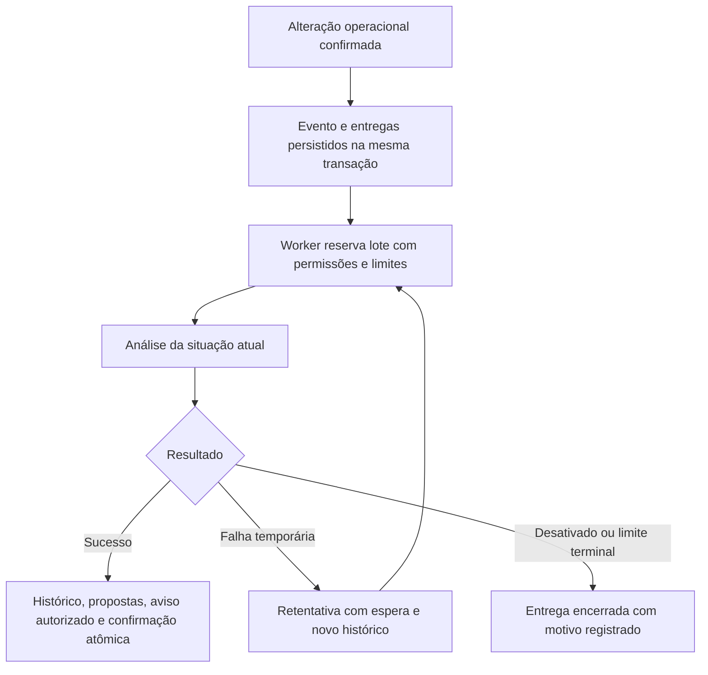

# KATUÁ Agents v1 — Etapa 3: Automações e Validação Operacional

**Data:** 04/11/2026. **Criadores e desenvolvedores:** Paulo Roberto Apolinario da Silva e Nilton Felipe de Oliveira Braz.

**Estado da entrega:** implementação pronta para homologação controlada, com validação multi-instância em PostgreSQL nativo ainda pendente. Não está liberada para implantação automática em produção. Código mantido na branch local `work/agents-v1-automation-20261104`, continuando os commits da etapa 2 (backend `283f044`, painel `e60770e`). Sem push, merge, migração na VPS ou reinício de serviços.

## 1. Implementação

O backend captura eventos operacionais em uma caixa persistente no próprio PostgreSQL. Triggers aditivos gravam evento e entregas aos agentes na mesma transação que confirma a alteração original. Isso cobre os serviços existentes, atualizações em lote, programação de rotas e reenvios offline, sem substituir os serviços de solicitação, coleta ou rota.

A captura ocorre somente para cooperativas com conta ativa do perfil COOPERATIVE e agentes habilitados para automação. Agentes desativados não recebem novas entregas; ao reativar, a rotina periódica consulta a situação atual. Não há promessa de auditoria de agentes para operações ocorridas enquanto eles estavam desativados.

| Origem | Mudanças acompanhadas | Agentes interessados |
|---|---|---|
| Schedule | Criação, status, datas e referências de programação/local | Coletas e Gestor |
| Collection | Criação, status, vínculos e versão da conferência | Coletas, Rotas e Gestor |
| Route | Criação, programação, equipe, veículo, sequência, pontos e cobertura | Rotas e Gestor |
| SystemAlert | Situação, prioridade, ciclo, adiamento e conteúdo relevante | Gestor |
| Vehicle, Driver, Collector | Disponibilidade e recursos relevantes | Rotas e Gestor |
| ExtraCollectionOrder, PevRequest | Criação, situação e vínculo operacional | Coletas e Gestor |

Alteração apenas de `updatedAt` não cria evento. O identificador persistente combina transação, origem, registro e assinatura dos campos relevantes; restrições únicas impedem gravações repetidas do mesmo evento/entrega. O hash compacto não é utilizado como assinatura de segurança.

O worker funciona no processo Node existente, inclusive sem usuário conectado. Não utiliza Redis, serviço externo, IA generativa ou modelo local. Nenhuma dependência foi adicionada às aplicações. Ferramentas de teste ficaram fora dos projetos.

## 2. Fluxos de execução



Eventos são sinais de que o estado precisa ser consultado novamente. O agente não reproduz uma operação antiga: uma solicitação cancelada antes do consumo não reaparece como atendimento ativo. Eventos próximos de uma mesma cooperativa/agente são analisados juntos, até o limite do lote.

Reserva de execução e entregas compartilham uma transação. Conclusão, propostas, InboxNotification e confirmação das entregas também compartilham uma transação. Uma interrupção entre essas etapas deixa metadados recuperáveis; não exige repetir mutações operacionais.

Cada tentativa tem AgentRun próprio. `eventDeliveryIds` conserva suas referências, mesmo quando uma entrega passa para outra tentativa. O resultado bem-sucedido inclui `eventSources`.

## 3. Frequências e limites

| Controle | Valor inicial |
|---|---|
| Habilitação global | `AGENTS_ENABLED=false` por padrão |
| Habilitação por agente/cooperativa | Desativada por padrão |
| Verificação do worker | A cada 60 segundos, sem sobreposição no processo |
| Espera inicial de evento | 60 segundos para permitir agrupamento |
| Intervalo por evento | 5 minutos por padrão; configurável de 1 a 60 |
| Rotina periódica | 60 minutos por padrão; configurável de 15 a 1440 |
| Lote | Até 20 entregas da mesma cooperativa/agente |
| Concorrência | Uma análise global e uma por cooperativa |
| Uso por cooperativa | Até 10 análises/minuto e 100 em janela de 24 horas |
| Retentativas de evento | Até três tentativas; espera inicial de 2 minutos, depois 10 minutos |
| Contenção ou quota antes da reserva | Nova elegibilidade em 1 ou 15 minutos, respectivamente |
| Orçamento de análise | 45 segundos para retornar resultado ou falha controlada |
| Lease persistente | 15 minutos para recuperação de execução interrompida |
| Evento antigo | Após sete dias sem conclusão, DEAD com motivo; registro preservado |
| Saída | Até 100 itens, 10 propostas e 20 validações detalhadas de rota |

Análise por evento cobre também o ciclo periódico do mesmo agente, adiando a próxima rotina para evitar consulta redundante. O worker deixa de iniciar novas rotinas periódicas se o ciclo já consumiu cinco segundos; uma análise iniciada ainda tem seu orçamento individual. Não existe garantia de atendimento no segundo exato: fila, frequência, quotas e indisponibilidade podem adiar a análise.

O limite de 45 segundos não cancela uma consulta SQL já em andamento. Resultado tardio não é confirmado e a vaga global fica protegida até a leitura terminar ou o lease vencer. Configuração e teste de `statement_timeout`/`lock_timeout` no PostgreSQL real fazem parte da homologação; não foram alterados parâmetros do banco da VPS.

## 4. Alertas, notificações e revisão humana

`SystemAlert`, `InboxNotification`, `refreshAlerts` e o envio de e-mail existente foram preservados. O Gestor chama o motor atual com um contexto transacional que impede a atualização dos próprios alertas de gerar novos eventos para ele. Atualizações reais pela central existente continuam podendo gerar eventos.

InboxNotification não é fonte de eventos. Ler aviso não resolve ocorrência. Propostas iguais reaproveitam sua impressão digital e não geram outro aviso. Ocorrências críticas da mesma categoria são agrupadas em uma recomendação quando há mais de uma, reduzindo notificações repetitivas.

Propostas são verificadas contra os registros atuais ao consultar detalhes/listas e antes de aprovar. Rota alterada, recursos alterados, solicitação cancelada/delegada ou ocorrência resolvida/adiada deixam a recomendação desatualizada. Aprovação retorna `409 STALE_PROPOSAL`; rejeição permanece disponível para registrar a revisão. Propostas antigas sem versões dos recursos exigem nova análise.

O ChatBox mostra “Dados alterados desde a análise” ao abrir um aviso antigo. A análise de origem é histórica e não é apresentada como estado atual. A fila persistente aparece na nova seção **Eventos operacionais** da Central, com situação, origem, tentativas e análise vinculada.

Nenhum agente cria ou altera automaticamente rotas, coletas, cadastros, quantidades, estoque ou destinações. Aprovar continua sendo apenas uma decisão consultiva registrada; não há endpoint ou botão de execução operacional.

## 5. APIs e tabelas

Nova API: **GET `/agents/events`**, com JWT/RBAC, escopo derivado do usuário, paginação, filtro por agente/situação e contadores da cooperativa. Estados: PENDING, PROCESSING, DONE, DEAD e SKIPPED. Cursor de outra cooperativa não é aceito.

APIs ampliadas:

- PATCH `/agents/:agent/config`: aceita `eventIntervalMinutes` de 1 a 60, preservando versão, evento idempotente e demais preferências.
- GET `/agents/proposals` e `/agents/proposals/:id`: incluem verificação de atualidade (`freshness`).
- POST `/agents/proposals/:id/decision`: bloqueia aprovação de proposta desatualizada.
- GET `/agents/runs/:id`: mantém histórico e referências das entregas que motivaram a execução.

Tabelas novas: **AgentEvent** (origem, registro, chave, assinatura e data) e **AgentEventDelivery** (agente, estado, disponibilidade, prazo, tentativa, execução e erro). Vínculos compostos incluem cooperativeId, impedindo associação de entrega a configuração, evento ou execução de outra cooperativa.

AgentConfig recebe `eventIntervalMinutes` e `nextEventAt`; AgentRun recebe `eventDeliveryIds`; AgentOrigin recebe EVENT. AgentProposal e AgentAuditEvent continuam sendo os registros de recomendações e auditoria. Os modelos operacionais anteriores não foram redefinidos.

## 6. Testes executados

**120 verificações aprovadas, uma pendente, zero falhas na rodada final.** Reexecuções substituíram evidências anteriores, sem aumentar a contagem.

| Grupo | Aprovadas | Pendentes |
|---|---:|---:|
| Backend das etapas anteriores, autenticação, comandos, isolamento e preferências | 66 | 0 |
| Eventos, falhas, retentativas, preservação, carga e rollback | 27 | 1 |
| Interface integrada, contexto histórico, fila, sessão e responsividade | 27 | 0 |
| **Total** | **120** | **1** |

Prisma validate, TypeScript e builds do backend/painel passaram. O lint completo do frontend passou com **zero erros e oito avisos anteriores**. Foram corrigidos os cinco erros anteriores de declarações sem uso em BarChart e WasteCollectionChart, sem alterar os cálculos ou as consultas desses gráficos.

### Cenários solicitados

| Cenário | Evidência e limite |
|---|---|
| 1. Solicitação com painel fechado | API real cria solicitação; evento e análise consumidos sem navegador conectado. |
| 2. Solicitação atrasada | Motivo baseado nas datas reais, sem alteração da solicitação. |
| 3. Cancelamento anterior à análise | Estado atual respeitado; nenhuma coleta fantasma criada. |
| 4. Rota alterada com sugestão pendente | Atualidade falsa e aprovação bloqueada no backend. |
| 5. Veículo indisponível | Evento de recurso e motivo de revisão; veículo preservado. |
| 6. Bairro próximo/dias incompatíveis | Nenhum agrupamento automático desses pedidos. |
| 7. Cooperativas semelhantes | Filas, resultados, propostas, APIs e interface isolados. |
| 8. Mesmo evento repetido | Mesma execução reaproveitada; avisos não duplicados. |
| 9. Interrupção/reinício | Recuperação de lease persistente simulado e retentativa; não foi feito kill/restart de PostgreSQL nativo. |
| 10. Desativação com pendência/análise | Entrega não processada ou resultado bloqueado, com histórico. |
| 11. Usuário sem permissão | Perfil bloqueado por JWT/RBAC e vínculo. |
| 12. Aviso antigo no ChatBox | Interface mostra contexto histórico e preserva decisão/leitura. |
| 13. Sincronização offline repetida | Solicitação usa operationId do serviço existente; uma solicitação/evento. |
| 14. Banco temporariamente indisponível | Falha P1001 injetada; pendência preservada e retomada. Queda real do banco nativo ainda precisa ser homologada. |
| 15. Agentes simultâneos | Uma vaga global verificada no processo; **disputa entre instâncias em PostgreSQL nativo pendente**. |

Também foram testados rollback da transação operacional, ausência de eventos por simples timestamp, prevenção de ciclo por alertas do próprio agente, três tentativas terminais, resultado tardio, perda de permissão durante execução, agrupamento de ocorrências e pausa/retomada dos triggers mantendo dados.

A pendência não foi convertida em aprovação: PGlite tem conexão física única e não certifica concorrência PostgreSQL real. A tentativa local com PostgreSQL nativo foi impedida porque o ambiente não permite executar com o usuário não-root requerido. O runner possui modo nativo para execução posterior em ambiente adequado.

## 7. Desempenho observado e riscos

A medição local com **mil solicitações adicionais**, captura de eventos e consumo de um lote levou **711 ms** nessa rodada. O processo do backend registrou **96 ms de CPU de usuário e 24 ms de sistema**; seu RSS amostrado foi de **256 para 270 MiB**. O resultado teve **28.055 bytes**, 20 eventos no lote e 100 itens apresentados.

Esses valores incluem preparação local do cenário e não são um benchmark da VPS de 1 vCPU. O CPU do banco não está incluído no CPU do backend. O processo separado de PGlite/WASM atingiu cerca de **1.228 MiB de pico durante toda a suíte**, incluindo bootstrap e testes de interface; isso não representa a memória esperada do PostgreSQL nativo em produção. Não se pode somar ou transferir esses números como garantia de capacidade da VPS.

O EXPLAIN da consulta crítica mostrou uso do índice `AgentEventDelivery_status_availableAt_createdAt_id_idx`. Permanecem necessários planos e carga concorrente no PostgreSQL real, incluindo impacto dos triggers sobre gravações normais e recursos consumidos por rotinas já existentes.

O pacote JavaScript principal do painel continua com aproximadamente 2,55 MB antes de gzip e o aviso anterior de divisão de código. Não houve otimização geral de carregamento nesta etapa.

Riscos a acompanhar na homologação: quota diária em cooperativas muito movimentadas, atraso de fila, retenção e crescimento em disco, consultas SQL em andamento após timeout e disponibilidade do processo Node. Sem API rodando não há consumo, mas eventos confirmados no banco permanecem persistidos.

## 8. Avaliação de segurança

- Ferramentas consultivas fechadas; texto não vira SQL ou execução de código.
- JWT, conta ativa, perfil COOPERATIVE e pertencimento à cooperativa. Permissão também conferida antes de confirmar resultado.
- Bloqueios transacionais PostgreSQL e estados persistidos na reserva; confirmação atômica com propostas/avisos. Comportamento multi-instância precisa da validação nativa pendente.
- Eventos e entregas com chaves únicas; não há consumo disparado por InboxNotification.
- Limites de lote, frequência, uso, tempo e tentativas; falhas terminais preservadas para revisão.
- Logs do worker usam identificadores e códigos, sem despejar CPF, endereço, conversa, token ou erro bruto do banco.
- Textos renderizados pelo React e links limitados a caminhos internos permitidos.
- Captura transacional pode impedir uma gravação operacional se houver erro no trigger ou falta de privilégio nas novas tabelas. Por isso, migração, permissões e rollback de captura são portas obrigatórias de homologação.

## 9. Migração e rollback

Nova migração: **20261104040000_agents_operational_events**. Depende das migrações das etapas 1 e 2 e dos módulos operacionais anteriores. Cria dois modelos, enum de estado, origem EVENT, campos/índices e nove triggers. Não apaga ou redefine dados operacionais.

As migrações foram aplicadas apenas no banco descartável. A validação parte do schema anterior e aplica as migrações incrementais dos agentes; não é um replay integral de todas as migrações históricas.

Plano de rollback, a executar somente após autorização:

1. Suspender agentes na Central ou desativar a flag global no processo. Alterar `.env` sozinho não muda o processo em execução; eventual reinício exige autorização.
2. Confirmar ausência de nova execução e registrar histórico/pendências.
3. Se necessário, aplicar `server/prisma/rollback/agents-events-pause.sql` no banco/schema correto. O script desabilita apenas os nove triggers de captura, preservando dados, filas, histórico e regras operacionais.
4. Restaurar a versão anterior do backend e o dist anterior do painel, mantendo o módulo global desligado. Guardar as novas tabelas/colunas; não fazer down-migration destrutiva nem remover valores de enum que já possuem registros.
5. Verificar os fluxos normais de solicitação, coleta e rota. A reversão de código não exige desfazer operações de coleta confirmadas após o deploy.
6. A retomada de captura usa `agents-events-resume.sql`, seguida de validação e ativação autorizada. Pausa e retomada foram testadas no banco descartável.

Backup é proteção adicional; restaurá-lo sobre produção sem conciliar operações posteriores poderia perder trabalho confirmado. Este plano prioriza reversão de código/captura com preservação dos registros.

## 10. Checklist para futura implantação na VPS

Nenhum item de escrita/reinício abaixo foi executado nesta entrega.

- [ ] Aprovação explícita para publicar/merge e, separadamente, para implantação.
- [ ] Registrar releases/SHAs e dist atualmente usados na VPS; preparar retorno à versão anterior.
- [ ] Executar teste multi-instância e queda/reinício de banco em PostgreSQL 16 de homologação separado.
- [ ] Medir CPU/RAM/disco e latência com carga concorrente representativa da cooperativa e dos demais processos da VPS.
- [ ] Definir alertas de backlog/DEAD, ajuste de quota, retenção e espaço disponível; não há expurgo automático nesta versão.
- [ ] Gerar backup e verificar restauração em banco separado.
- [ ] Conferir privilégios do usuário da aplicação sobre tabelas, função e triggers novos.
- [ ] Manter AGENTS_ENABLED=false durante publicação, migrações e validação inicial.
- [ ] Após autorização, aplicar migrations incrementais, gerar Prisma Client e construir o backend em `/var/www/katua/app/server`; usar migrate deploy, sem reset/db push.
- [ ] Construir o painel em `/var/www/katua/frontend/frontend` com VITE_API_BASE_URL=https://vps.katua.com.br.
- [ ] Reiniciar o serviço `katua-api.service` somente com autorização; não há requisito de PM2 nem mudança de Nginx nesta entrega.
- [ ] Conferir login, APIs, notificações atuais e operações normais com os agentes ainda desativados.
- [ ] Ativar primeiro uma cooperativa de homologação, verificar evento sem painel, repetição, proposta antiga e desativação.
- [ ] Validar fila e logs, tempos, limites, retentativas e plano de rollback antes de ampliar a ativação.

## 11. Reprodução e arquivos

Teste combinado local descartável, a partir da raiz do backend, após build do painel:

```bash
AGENTS_EVENTS=1 AGENTS_UI=1 AGENTS_EVENTS_UI=1 \
KATUA_AGENTS_UI_RUNNER=/caminho/painel/tests/agents/browser.mjs \
KATUA_PANEL_DIST=/caminho/painel/frontend/dist \
KATUA_VALIDATION_TOOLS=/caminho/ferramentas \
KATUA_CHROMIUM_BIN=/caminho/chromium \
node server/tests/agents/run.mjs
```

O modo nativo aceita KATUA_NATIVE_POSTGRES_BIN apontando para binários PostgreSQL em ambiente com usuário não-root. Cria diretório e banco novos em loopback, porta 54329; não deve receber conexão de produção. A reprodução da disputa de instâncias permanece pendente até esse modo poder ser executado.

Evidências: `docs/agents-v1-etapa-3-validacao.json`. O painel inclui `docs/agents-v1-etapa-3-evidence/historical-context.png`, captura com dados descartáveis.

Novos módulos: agents.events.ts, agents.event-lifecycle.ts e agents.freshness.ts. Foram ampliados configuração, execução, recuperação, análise de rotas, Gestor, propostas, schemas, rotas e triggers dos agentes. settings.alerts.ts recebeu somente a opção transacional de origem para evitar realimentação; o motor e e-mails existentes continuam sendo usados.

No painel foram ampliados AgentChat, AnalysisResult, ProposalCard, AgentsCenter e agentsService; testes de navegador cobrem fila e contexto histórico. A limpeza de lint afetou somente declarações sem uso em BarChart e WasteCollectionChart. O runner de navegador agora também registra falha de infraestrutura como falha, evitando um resultado falso de zero testes aprovados/zero falhas.

Os helpers de testes incluem cenários de eventos, worker de teste e banco nativo descartável. O inventário completo dos arquivos desta etapa segue no anexo.

### Anexo — inventário da alteração

Backend:

- `docs/agents-v1-etapa-3-validacao.json`
- `docs/agents-v1-etapa-3.md`
- `server/prisma/migrations/20261104040000_agents_operational_events/migration.sql`
- `server/prisma/rollback/agents-events-pause.sql`
- `server/prisma/rollback/agents-events-resume.sql`
- `server/prisma/schema.prisma`
- `server/src/modules/agents/agents.config.ts`
- `server/src/modules/agents/agents.event-lifecycle.ts`
- `server/src/modules/agents/agents.events.ts`
- `server/src/modules/agents/agents.execution.ts`
- `server/src/modules/agents/agents.freshness.ts`
- `server/src/modules/agents/agents.manager.ts`
- `server/src/modules/agents/agents.proposals.ts`
- `server/src/modules/agents/agents.recovery.ts`
- `server/src/modules/agents/agents.routes-analysis.ts`
- `server/src/modules/agents/agents.routes.ts`
- `server/src/modules/agents/agents.schemas.ts`
- `server/src/modules/agents/agents.triggers.ts`
- `server/src/modules/agents/agents.types.ts`
- `server/src/modules/settings/settings.alerts.ts`
- `server/tests/agents-events/integration.ts`
- `server/tests/agents-events/native-db.mjs`
- `server/tests/agents-events/worker.ts`
- `server/tests/agents/integration.ts`
- `server/tests/agents/run.mjs`

Painel:

- `docs/agents-v1-etapa-3-evidence/historical-context.png`
- `docs/agents-v1-etapa-3-validacao.json`
- `docs/agents-v1-etapa-3.md`
- `frontend/src/components/BarChart.jsx`
- `frontend/src/components/WasteCollectionChart.jsx`
- `frontend/src/components/agents/AgentChat.jsx`
- `frontend/src/components/agents/AnalysisResult.jsx`
- `frontend/src/components/agents/ProposalCard.jsx`
- `frontend/src/pages/agents/AgentsCenter.jsx`
- `frontend/src/services/agentsService.js`
- `tests/agents/browser.mjs`
